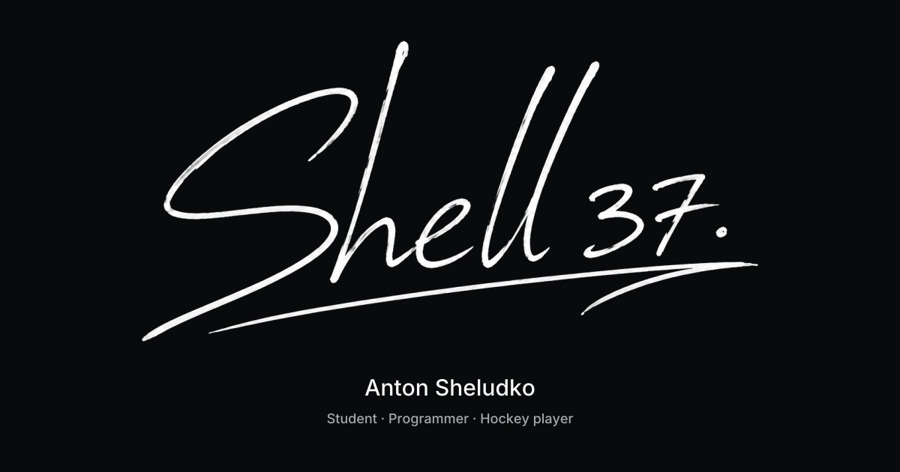

<p align="center">
  <a href="https://anton-sheludko.vercel.app">
    
  </a>
</p>

<h1 align="center">Anton Sheludko · Official Website</h1>

<p align="center">Student. Programmer. Hockey player.</p>

<p align="center">
  <a href="https://anton-sheludko.vercel.app"><strong>Visit the website ↗</strong></a>
  &nbsp;·&nbsp;
  <a href="https://github.com/AntonShell7/eaglish">Explore Eaglish</a>
  &nbsp;·&nbsp;
  <a href="mailto:antonsheludko37@gmail.com">Get in touch</a>
</p>

---

My personal website brings together the projects I build, the things I’m learning, and fourteen years of life on the ice. It follows my journey from Vladivostok to Saint Petersburg through real photographs, experiences, and achievements.

## Inside the portfolio

- **About me** — programming, mathematics, independent living, and the next chapter of my education.
- **Eaglish** — the English-learning platform I built, from a personal learning problem to a working product.
- **Life on the ice** — a chronological hockey journey through HC Polyus, HC Admiral, and ITMO University’s Kronverkskie Barsy.
- **Photo journal** — personal moments and the words that keep me moving forward.
- **Awards & certificates** — programming, data analysis, chess, and hockey, with full document previews and original downloads.
- **Contact** — email, GitHub, Instagram, and LinkedIn.

## Design & functionality

A dark, minimal interface with Inter typography, handwritten accents, original photography, and my own signature. The layout adapts to mobile and desktop, with keyboard-accessible navigation, document dialogs, and reduced-motion support.

The separate owner admin supports creating, editing, publishing, and deleting achievements. Documents and previews live in private storage; only published entries are available to visitors. The gallery is rendered on the server, so its content is available before JavaScript loads.

## Built with

| Layer | Technology |
| --- | --- |
| Interface | HTML, CSS, vanilla JavaScript |
| Typography | Locally hosted Inter and Caveat |
| Server | Node.js 24 · Web-standard Request/Response API |
| Hosting | Vercel · static assets and a serverless function |
| Documents | Private Vercel Blob storage |
| Build | esbuild for the admin upload client |
| Checks | Node.js test runner |

## Run locally

Requires **Node.js 24** and npm.

```sh
git clone https://github.com/AntonShell7/anton-sheludko.git
cd anton-sheludko
npm ci
npm run build
npm test
npm run dev
```

Open **http://127.0.0.1:8000**. The local admin is at **/admin**.

Local development uses a separate disk-backed collection in `work/local-data`; it does not connect to production documents. Owner access is enabled only on the loopback development server. Use `PORTFOLIO_LOCAL_ADMIN=0 npm run dev` to preview anonymous access.

## Project structure

```text
public/              Pages, styles, scripts, photographs, fonts, and icons
api/index.mjs        Vercel entry point and upload authorization
worker/index.js      Portfolio routes, award rendering, and document validation
lib/                 Private Blob adapter and owner authentication
scripts/             Build, local development, validation, and migration tools
tests/               Access control, document lifecycle, and upload checks
vercel.json          Hosting configuration
```

## Deployment & owner administration

The official website runs at **[anton-sheludko.vercel.app](https://anton-sheludko.vercel.app)**. The build command is `npm run build`, with `dist/static` as the output directory and `api/index.mjs` handling dynamic routes.

Configure these server-side environment variables in Vercel:

| Variable | Purpose |
| --- | --- |
| `BLOB_READ_WRITE_TOKEN` | Access to the connected private Blob store |
| `PORTFOLIO_ADMIN_EMAIL` | Owner login |
| `PORTFOLIO_ADMIN_KEY_SHA256` | SHA-256 digest of a randomly generated owner access key |

The owner signs in at `/admin` over HTTPS. Writes require owner authentication and a same-origin request. Uploads are limited to **10 MB** for original documents and **2 MB** for previews; the server validates file contents before saving. Temporary uploads expire automatically.

Credentials, production document backups, and generated builds are excluded from this repository. Award records and uploaded certificates are stored separately from the source code.

## Personal media & credits

This repository is shared as my personal portfolio project. My photographs, signature, biography, and certificate materials are not offered as reusable template content. Inter and Caveat retain their bundled [font licenses](public/fonts/).

---

<p align="center">Code, curiosity & fourteen years on the ice.<br><a href="https://anton-sheludko.vercel.app">anton-sheludko.vercel.app</a></p>
